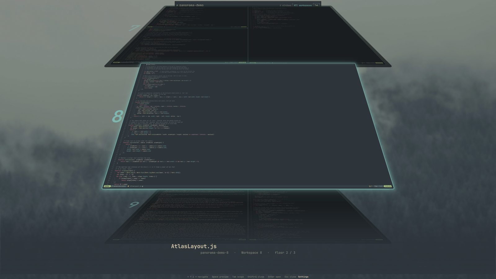
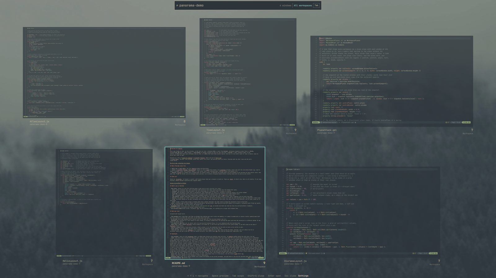
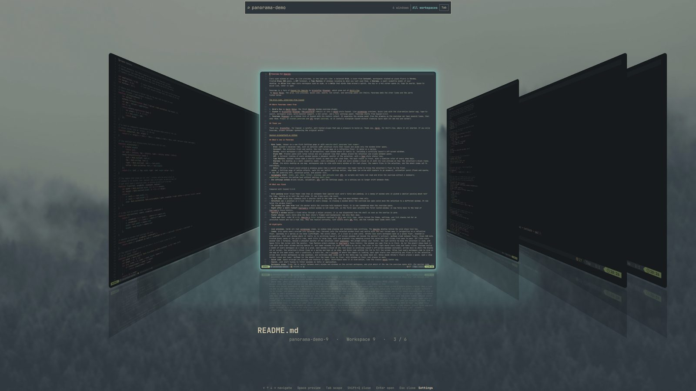
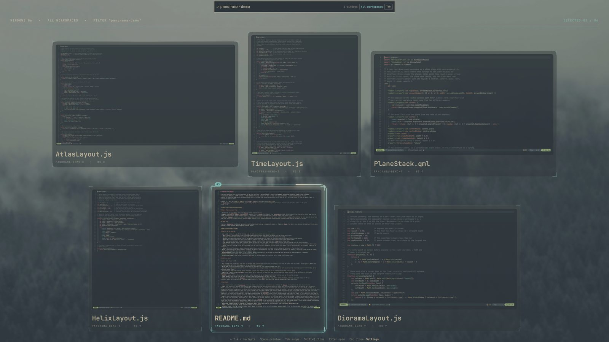
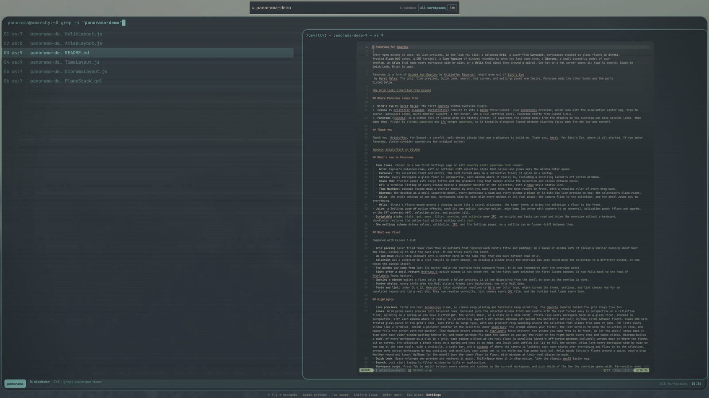
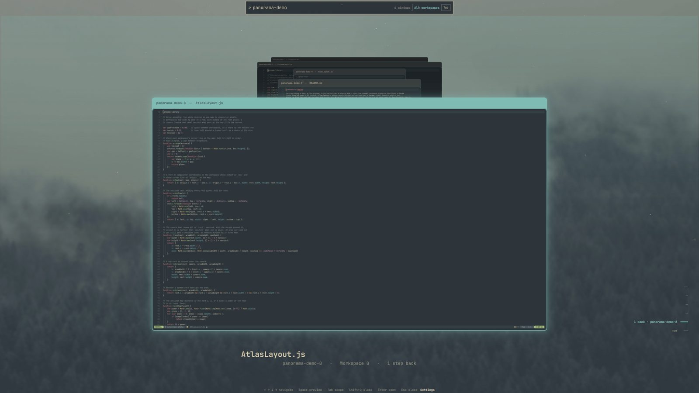
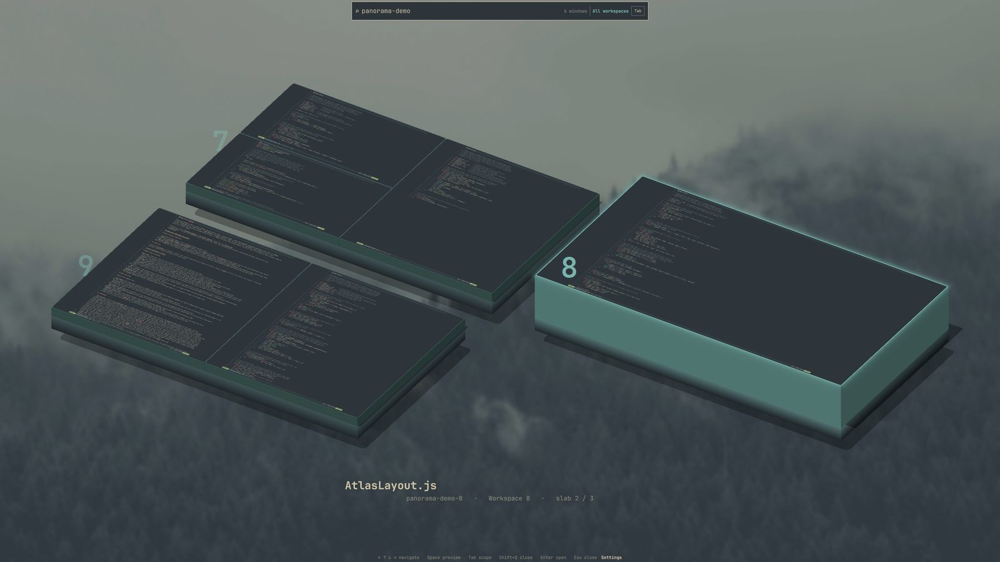
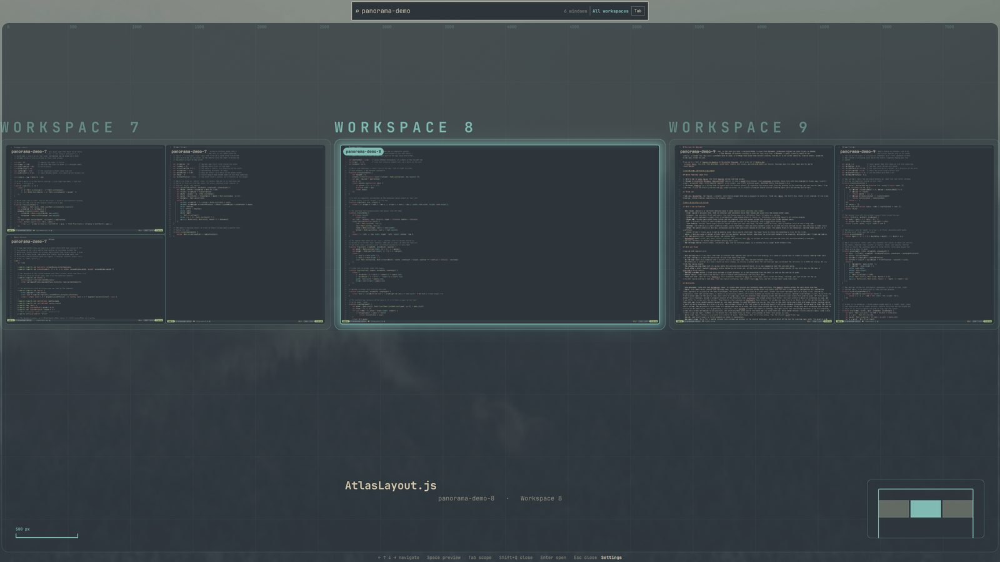
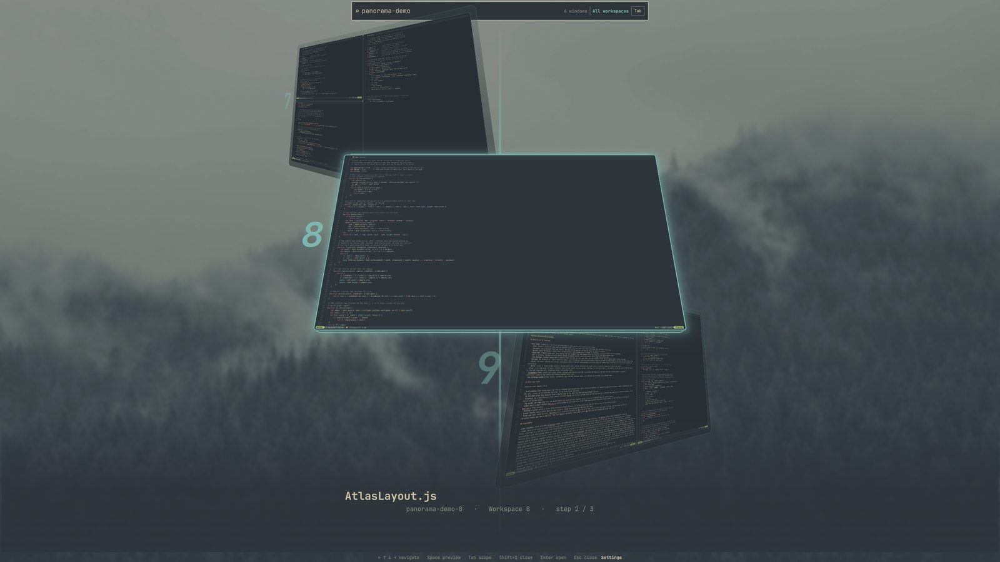

# Panorama for Omarchy

Every open window at once, as live previews, in the look you like: a balanced **Grid**, a cover-flow **Carousel**, workspaces stacked as glass floors in **Strata**, frosted **Glass HUD** panes, a **CRT** terminal, a **Time Machine** of windows receding by when you last used them, a **Diorama**, a small isometric model of your desktop, an **Atlas** that maps every workspace side by side, or a **Helix** that winds them around a spiral. One key or a hot corner opens it; type to search, Space to Quick Look, Enter to open.

Panorama is a fork of [Exposé for Omarchy](https://github.com/kristofferR/omarchy-expose) by Kristoffer Risanger, which grew out of [Bird's Eye](https://github.com/harel/omarchy-birdseye) by Harel Malka. The grid, live previews, Quick Look, search, hot corner, and settings panel are theirs; Panorama adds the other looks and the parts listed below.



## The looks

<table>
  <tr><td align="center"><a href="docs/screenshots/grid.jpg"></a><br><b>Grid</b></td><td align="center"><a href="docs/screenshots/carousel.jpg"></a><br><b>Carousel</b></td><td align="center"><a href="docs/screenshots/strata.jpg"></a><br><b>Strata</b></td></tr>
  <tr><td align="center"><a href="docs/screenshots/hud.jpg"></a><br><b>Glass HUD</b></td><td align="center"><a href="docs/screenshots/crt.jpg"></a><br><b>CRT</b></td><td align="center"><a href="docs/screenshots/time.jpg"></a><br><b>Time Machine</b></td></tr>
  <tr><td align="center"><a href="docs/screenshots/diorama.jpg"></a><br><b>Diorama</b></td><td align="center"><a href="docs/screenshots/atlas.jpg"></a><br><b>Atlas</b></td><td align="center"><a href="docs/screenshots/helix.jpg"></a><br><b>Helix</b></td></tr>
</table>

Screenshots show throwaway terminals on three empty workspaces (Panorama's own source files in nvim), filtered with `panorama-demo`.

## Where Panorama comes from

1. **Bird's Eye** by Harel Malka: the first Omarchy window overview plugin.
2. **Exposé** by Kristoffer Risanger (@kristofferR) rebuilt it into a macOS-style Exposé: live screencopy previews, Quick Look with the slow-motion Easter egg, type-to-search, workspace scope, multi-monitor support, a hot corner, and a full settings panel. Panorama starts from Exposé 5.0.0.
3. **Panorama** (@igouss) is a GitHub fork of Exposé with its history intact. It separates the window model from the drawing so the overview can have several looks, then adds them. Plugin id `elendal.panorama` and IPC target `panorama`, so it installs alongside Exposé without clashing (give each its own key and corner).

## Thank you

Thank you, Kristoffer, for Exposé: a careful, well-tested plugin that was a pleasure to build on. Thank you, Harel, for Bird's Eye, where it all started. If you enjoy Panorama, please consider sponsoring the original author:

[](https://github.com/sponsors/kristofferR)

## What's new in Panorama

- **Nine looks**, chosen on a new first Settings page or with `omarchy-shell panorama look <name>`:
  - **Grid**: Exposé's balanced rows, with an optional **Lift** selection style that raises and glows only the window Enter opens.
  - **Carousel**: the selection front and centre, the rest turned away on a reflective floor; it spins on a spring.
  - **Strata**: every workspace a glass floor in perspective, each window where it really is, including a scrolling layout's off-screen windows.
  - **Glass HUD**: frosted panes with large titles and one gradient ring that sweeps around the selection and slides between panes.
  - **CRT**: a terminal listing of every window beside a phosphor monitor of the selection, with a tmux-style status line.
  - **Time Machine**: windows recede down a starlit tunnel by when you last used them, the most recent in front, with a timeline ruler of every step back.
  - **Diorama**: the desktop as a small isometric model, every workspace a slab and every window a block on it with its live preview on top; the selection's block rises.
  - **Atlas**: the whole desktop as one map, workspaces side by side with every window at its real place; the camera flies to the selection, and the wheel zooms out to everything.
  - **Helix**: Strata's floors wound around a glowing spine like a spiral staircase; the tower turns to bring the selection's floor to the front.
- **Juice**: a Settings page of motion effects, each its own switch: springy motion, edge bump (an arrow with nowhere to go answers), activation punch (flash and sparks, or the CRT powering off), selection pulse, and pointer tilt.
- **Scriptable state**: `state`, `get`, `move`, `filter`, `preview`, and `activate` over IPC, so scripts and tests can read and drive the overview without a keyboard; `showFooter` restores the bottom text without editing `shell.json`.
- **One settings schema** drives values, validation, IPC, and the Settings pages, so a setting can no longer drift between them.

## What was fixed

Compared with Exposé 5.0.0:

- **Grid packing** never tried fewer rows than an estimate that ignored each card's title and padding; in a sweep of window sets it picked a smaller packing about half the time, losing up to half the card area. It now tries every row count.
- **Up and Down** could step sideways onto a shorter card in the same row; they now move between rows only.
- **Selection** was a position in a list rebuilt on every change, so closing a window while the overview was open could move the selection to a different window. It now holds the window itself.
- **The window you came from** lost its marker while the overview held keyboard focus; it is now remembered when the overview opens.
- **Right after a shell restart** Hyprland's active window is not known yet, so the first open selected the first listed window; it now falls back to the head of Hyprland's focus history.
- **Opening a window** waited a fixed delay through a helper process; it is now dispatched from the shell as soon as the overlay is gone.
- **Footer styles**: every style drew the Rail style's framed card background; now only Rail does.
- **Tests and lint**: under Qt 6.12, Omarchy's `Color` singleton resolved to Qt's own `Color` type, which turned the theme, settings, and lint checks red for an unrelated reason and hid a real bug. They now resolve correctly, lint covers every QML file, and the runtime test loads every look.

## Requirements

- Omarchy Quattro with the native shell plugin system
- `jq`

The underlying Quickshell, Hyprland, Bash, and coreutils support ships with Omarchy, so no separate compositor setup is needed.

## Install

```sh
omarchy plugin add https://github.com/igouss/omarchy-panorama.git --enable
```

That's it: the top-left hot corner works right away. Optionally, bind a key in `~/.config/hypr/bindings.lua`, then run `hyprctl reload`:

```lua
o.bind("SUPER + A", "Panorama", hl.dsp.event("elendal.panorama:toggle"))
```

Any unused chord works. Avoid modifier-only bindings such as standalone Super; Hyprland cannot reliably distinguish them from the start of normal Super shortcuts.

To keep workspace swipes from changing the desktop behind Panorama, replace your workspace gesture in `~/.config/hypr/input.lua` with:

```lua
local panorama_gesture_path = os.getenv("HOME") .. "/.config/omarchy/plugins/elendal.panorama/workspace-gesture.lua"
local panorama_gesture_loader = loadfile(panorama_gesture_path)
if panorama_gesture_loader then
  panorama_gesture_loader()({ fingers = 4, scale = 0.5 })
else
  hl.gesture({ fingers = 4, direction = "horizontal", scale = 0.5, action = "workspace" })
end
```

Adjust `fingers` and `scale` to match your preferred gesture. Only the workspace gesture is swallowed while Panorama is open; media keys and other compositor shortcuts keep working.

### Update

```sh
omarchy plugin update elendal.panorama --yes
```

### Remove

Delete the Panorama binding from `~/.config/hypr/bindings.lua`, then:

```sh
omarchy plugin remove elendal.panorama --yes
hyprctl reload
```

Removal leaves nothing behind: Panorama keeps no files outside its plugin directory and its entry in `~/.config/omarchy/shell.json`.

## Documentation

- [Highlights](docs/highlights.md): what the overview does
- [Controls](docs/controls.md): keys and pointer
- [Settings](docs/settings.md): every setting, and the IPC commands
- [Security and system changes](docs/security.md): what Panorama changes on your system
- [Troubleshooting](docs/troubleshooting.md): when something looks wrong

## Credits

Panorama is a fork of [Exposé for Omarchy](https://github.com/kristofferR/omarchy-expose) by Kristoffer Risanger, itself based on [Bird's Eye](https://github.com/harel/omarchy-birdseye) by Harel Malka. Both are MIT licensed, as is Panorama.

## License

MIT
